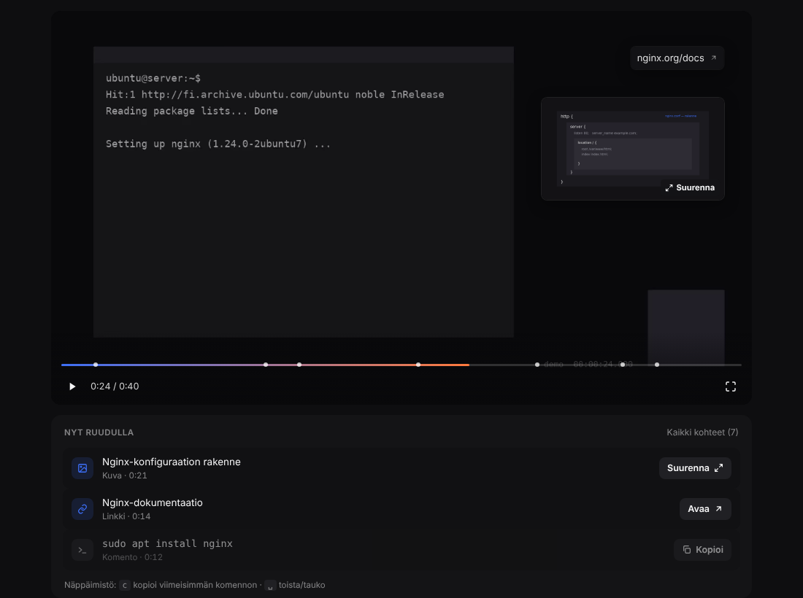

# @taso/player

`<taso-player>` toistaa Taso-manifestin: video pohjalla, kohteet DOM-kerroksena sen päällä ja
"Nyt ruudulla" -lista alla. Ei riippuvuuksia kehyksiin, ~11 kt gzipattuna.



## Käyttö

```html
<script type="module" src="/dist/taso-player.js"></script>
<taso-player src="/video.taso.json"></taso-player>
```

| Attribuutti | Merkitys |
|---|---|
| `src` | manifestin URL (suhteellinen sivuun) |
| `lang` | UI-kielen ylikirjoitus (`fi`, `en`); oletus manifestin `lang` |
| `list="off"` | piilottaa "Nyt ruudulla" -listan |
| `theme="dark" \| "light"` | pakottaa teeman; oletus tumma, vaalea jos sivu julistaa `color-scheme: light` |
| `hls-js` | hls.js:n URL, ladataan vain jos selain ei toista HLS:ää natiivisti eikä MP4:ää ole |

Tapahtumat: `taso-ready { manifest }`, `taso-action { item, action }`, `taso-error { error }`.
Ominaisuudet: `player.currentTime` (ms), `player.visibleItems`, `player.load(urlTaiObjekti)`.

Näppäimistö kun soitin on fokusoitu: `␣`/`k` toista/tauko, `←`/`→` ±5 s, `c` kopioi viimeisimmän
komennon, `f` koko näyttö, `Esc` sulkee kuvan.

## Miten se toimii

- **Kerros** on `div`, joka asetetaan täsmälleen videon kuva-alan kokoiseksi (letterbox lasketaan).
  Kohteet sijoitetaan prosentteina ja fonttikoko on `calc(var(--taso-vh) * koko)`, joten sama
  manifesti näyttää samalta 360p:ssä ja 4K:ssa.
- **Synkronointi** `requestVideoFrameCallback`illa (fallback `requestAnimationFrame`). Aktiiviset
  kohteet lasketaan inkrementaalisella pyyhkäisyllä ([`timeline.ts`](src/timeline.ts)); haku
  taaksepäin rakentaa tilan uudelleen.
- **Toiminnot**: `copy` kopioi täsmälleen `content`-merkkijonon, `open` on oikea `<a>` jossa
  `rel="noopener noreferrer"` ja kohdedomain tooltipissa, `expand` avaa kuvan lightboxiin, `seek`
  hyppää videossa. Maininnat ratkaistaan `(platform, id)`-parista.
- **Lista** näyttää aktiiviset kohteet ja pitää poistuneet `listLinger`-ajan himmennettyinä. Hypyn
  jälkeen lista täydennetään takautuvasti, jotta `c` ja lista kertovat totuuden.
- **Teema** CSS-muuttujina (`--taso-accent`, `--taso-surface`, …), ylikirjoitettavissa isäntäsivulta.

## Kehitys

```sh
npm install
npm run dev        # avaa demo/index.html Vitellä
npm test           # node --test, ei riippuvuuksia
npm run typecheck
npm run build      # dist/taso-player.js + d.ts
```

Ilman npm-rekisteriä: `tsc -p tsconfig.json --noEmit` ja
`bun build src/index.ts --outdir dist --target browser --format esm --minify --entry-naming taso-player.js`.

Demo: [`demo/`](demo/) sisältää 40 sekunnin generoidun videon (MP4 + WebM, Chromiumin
avoimen lähdekoodin versio ei toista H.264:ää) ja manifestin seitsemällä kohteella.

## Tiedossa olevat puutteet (prototyyppi)

- Tauon aikana ohjainpalkki peittää kuva-alan alareunan kohteet; `box.safe` ei ole vielä toteutettu.
- Ei `subtitles`- eikä `terminal`-raitojen toistoa.
- Linkin avaamista ei vielä vahvisteta erillisellä kehotteella; domain näkyy vain tooltipissa.
- Kosketuslaitteilla kerroksen kohteet ovat pieniä; lista on ensisijainen reitti, kuten suunniteltu.
